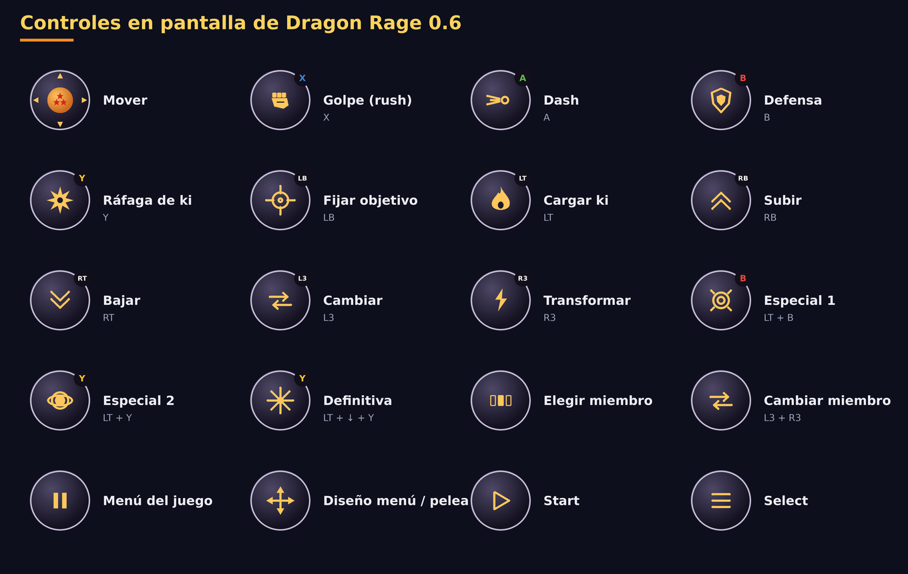

# Dragon Rage 0.6.0

La actualización más grande hasta ahora: **todo lo nuevo del port para PC**, un **nuevo menú dentro del juego hecho para
pantallas táctiles**, la app **identifica tu GPU y te ofrece ajustes para 30 fps estables**, **descarga de drivers** para
Snapdragon, una página de **Depuración** con log de rendimiento, el nuevo control en pantalla **Dragón**, **orientación
vertical y automática**, y **español**.

## Lo más destacado

### Todo lo nuevo del port para PC
- **Tenkaichi Budokai Online**: el menú principal tiene sus propias pantallas online (partida rápida, crear sala, unirse
  con código, perfil), dibujadas al estilo del juego.
- **Fuentes de menú, de combate y de diálogo** para elegir (página Interfaz del menú dentro del juego) y **paneles de
  luchadores** para las barras laterales de la imagen en 4:3.
- **Profundidad precisa**: dos superficies en un mismo plano (una cascada sobre su roca, marcas en el suelo) ya no
  parpadean, y desaparecieron los puntitos blancos en los personajes brillantes. Las sombras planas ya no muestran partes
  del cuerpo superpuestas (stencil).
- **Canciones en MP3**: un `.mp3` en la carpeta de canciones lo convierte el propio juego.
- **Dragon History**: *Pelear de nuevo* en el menú de pausa. Online: una seed por partida, las opciones de cámara del otro
  jugador limitadas a sus rangos, el menú de pausa ya no detiene una pelea online, peticiones firmadas al servicio de
  matchmaking.
- El código del port para PC ahora está bajo la **AGPL-3.0** (mira el README); Dragon Rage lo sigue.

### Un nuevo menú dentro del juego
- Hecho para dedos y mandos, con los colores del launcher: una barra lateral de páginas, interruptores grandes, opciones
  como filas de botones, deslizadores anchos; L1 / R1 cambian de página, B vuelve atrás.
- En **inglés, portugués o español**, igual que la app.
- Páginas: Video, **Rendimiento** (profundidad precisa, saltar cuadros, movimiento suave, modo de presentación, un panel
  de diagnóstico con tasa de cuadros, GPU, renderizador, resolución y dispositivo), Efectos, Audio, Interfaz, Controles
  (choques, mando físico), **Online** (cómo funciona y qué hacer cuando falla) y Trucos.
- Se quitaron las opciones exclusivas de PC (pantalla completa, monitor, V-sync, asignación de teclado). *Salir a la app*
  está arriba del todo.

### Tu GPU, a 30 fps
- La app lee el nombre de tu GPU y encuentra su **nivel** en una tabla con las familias de GPU de los últimos diez años
  (Adreno, Mali, Immortalis, Xclipse, PowerVR, Maleoon): básica, débil, intermedia, potente o gama alta.
- La primera vez que se abre te muestra *"Detectamos tu GPU: … Para mantener las peleas a 30 cuadros por segundo
  estables, vamos a aplicar estas optimizaciones:"* con la lista (resolución, movimiento suave, profundidad precisa,
  saltar cuadros, desenfoques) y te pregunta. Nada cambia sin tu sí; *Depuración* te lo vuelve a ofrecer.
- **El renderizador automático ahora es Vulkan en todas las GPUs.** La 0.5.0 elegía OpenGL ES para Mali, pero las peleas
  en una Mali-G52 iban a 2–3 cuadros por segundo así. El renderizador OpenGL ES también se volvió mucho más rápido en
  Mali: sus datos de uniform ahora van a un anillo de buffers en lugar de a uno solo reescrito 2 000 veces por cuadro.
- Nuevos ajustes: **Profundidad precisa** (desactivada va más rápido en GPUs débiles) y **Saltar cuadros en vez de ir
  lento**.

### Drivers
- Una página de **Drivers**: las últimas versiones de **Mr. Purple**, **StevenMXZ** y **K11MCH1**, directo desde GitHub,
  descargadas, instaladas y elegidas con un toque; importa un `.zip` desde tus archivos; elimina los que no uses.
- En una GPU que no es Adreno, la página indica que los drivers personalizados no aplican ahí.

### Depuración
- Tu dispositivo (modelo, SoC, Android, RAM), la GPU y su nivel, el renderizador.
- **Log de rendimiento**, activado por defecto y sin un costo que se note: la velocidad de la última sesión en peleas y
  menús y sus cuadros por segundo, leídos del log del juego.
- *Exportar log* (se movió aquí desde Ajustes).

### Control en pantalla
- Nuevo estilo **Dragón**, el predeterminado: botones redondos oscuros con iconos dorados, letras con los colores de Xbox
  (A verde, B rojo, X azul, Y amarillo; LB, RB, LT, RT, L3), una Esfera del Dragón de tres estrellas como stick. El
  estilo **Cristal** de la 0.5 y el mando clásico siguen como opciones (página Controles).
- **Corrección: en el modo historia, la distribución automática de menú / pelea a veces se quedaba en los botones de
  pelea** en el mapa y en las conversaciones: el juego mantiene ahí la última pelea marcada como en curso. Ahora el motor
  avisa cuando se están ejecutando sus menús.

### Launcher
- **Español**, y el idioma de la app sigue al del teléfono (portugués, inglés o español; inglés en cualquier otro caso).
- **Orientación**: horizontal, vertical (la imagen arriba, los controles debajo) o automática.
- Un nuevo botón **Jugar** con aura de ki, siluetas genéricas de luchadores en el fondo, enlaces a YouTube, Discord,
  Ko-fi y GitHub, y una tarjeta **Online** que explica cómo funciona el online y qué hacer cuando no conecta.

## Notas de la actualización
- Se instala encima de la 0.5.0 y conserva los datos del juego, ajustes, partidas guardadas, packs de texturas y la
  distribución del control.
- Tu control conserva sus letras; el estilo pasa a ser Dragón (Controles → Estilo → Cristal recupera el anterior).
- La app sigue necesitando tu propia imagen de disco de la versión de EE. UU. (SLUS-21678); no distribuye ningún dato
  del juego.
