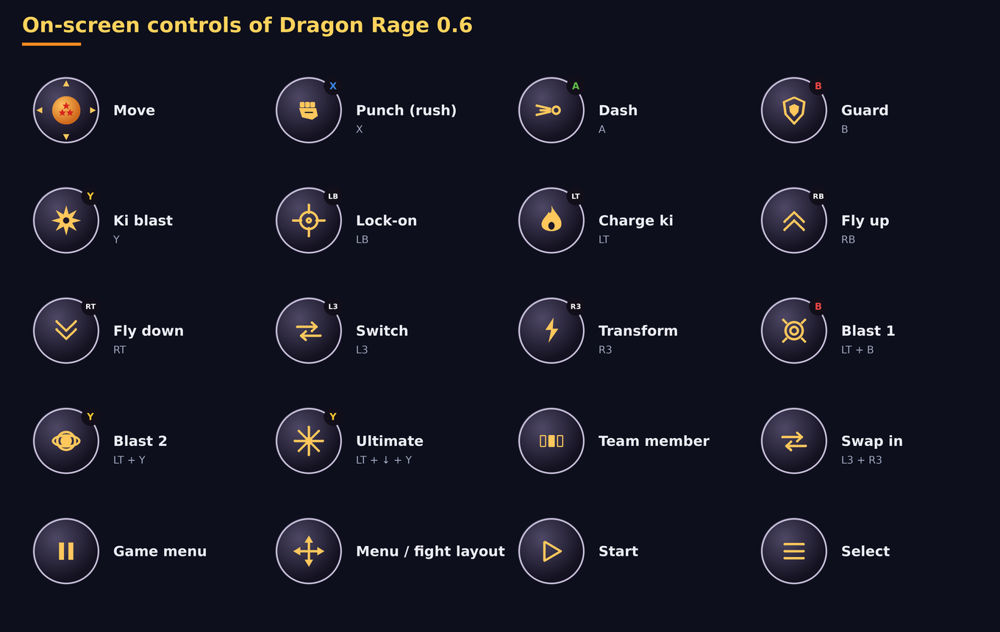

# Dragon Rage 0.6.0

The biggest update so far: **everything new in the PC port**, a **new in-game menu made for touch**, the app **finds
your GPU and offers settings for a steady 30 fps**, **driver downloads** for Snapdragon, a **Debug** page with a
performance log, the new **Dragon** on-screen controller, **portrait and automatic orientation**, and **Spanish**.

## Highlights

### Everything new in the PC port
- **Tenkaichi Budokai Online**: the main menu has its own online screens (quick match, create a room, join with a
  code, profile), drawn in the game's style.
- **Menu, battle and dialogue fonts** to choose from (Interface page of the in-game menu), and **fighter panels** for
  the side bars of a 4:3 picture.
- **Precise depth**: two surfaces in one plane (a waterfall on its rock, marks on the ground) no longer blink, and the
  white dots on shiny characters are gone. Flat shadows no longer show overlapping body parts (stencil).
- **Songs in MP3**: an `.mp3` in the songs folder is converted by the game itself.
- **Dragon History**: *Fight Again* in the pause menu. Online: a seed per match, the other side's camera options held
  to their ranges, the pause menu no longer stops an online fight, signed requests to the matchmaking service.
- The PC port's code is now under the **AGPL-3.0** (see the README); Dragon Rage follows it.

### A new in-game menu
- Made for fingers and controllers, in the launcher's colours: a side bar of pages, big switches, choices as rows of
  buttons, wide sliders; L1 / R1 change the page, B goes back.
- In **English, Portuguese or Spanish**, the same as the app.
- Pages: Video, **Performance** (precise depth, skip pictures, smooth motion, present mode, a diagnostics panel with
  frame rate, GPU, renderer, resolution and device), Effects, Audio, Interface, Controls (clashes, physical
  controller), **Online** (how it works and what to do when it fails) and Cheats.
- The PC-only options are gone (full screen, display, V-sync, keyboard bindings). *Quit to launcher* is at the top.

### Your GPU, at 30 fps
- The app reads your GPU's name and finds its **tier** in a table of the GPU families of the last ten years (Adreno, Mali,
  Immortalis, Xclipse, PowerVR, Maleoon): entry level, weak, mid-range, strong or flagship.
- On the first start it shows *"We found your GPU: … To keep fights at a steady 30 pictures a second, we will apply:"*
  with the list (resolution, smooth motion, precise depth, skip pictures, blurs) and asks. Nothing changes without
  your yes; *Debug* offers it again.
- **Automatic renderer is now Vulkan on every GPU.** 0.5.0 picked OpenGL ES for Mali, but a Mali-G52's fights ran at
  2–3 pictures a second there. The OpenGL ES renderer also got much faster on Mali: its uniform data now goes to a
  ring of buffers instead of one rewritten 2 000 times a frame.
- New settings: **Precise depth** (off is faster on weak GPUs) and **Skip pictures instead of slowing down**.

### Drivers
- A **Drivers** page: the latest releases of **Mr. Purple**, **StevenMXZ** and **K11MCH1**, straight from GitHub,
  downloaded, installed and chosen in one tap; import a `.zip` from your files; remove the ones you do not use.
- On a GPU that is not an Adreno the page says that custom drivers do not apply there.

### Debug
- Your device (model, SoC, Android, RAM), the GPU and its tier, the renderer.
- **Performance log**, on by default and with no cost you can feel: the last run's speed in fights and menus and its
  pictures a second, read from the game's log.
- *Export log* (moved here from Settings).

### On-screen controller
- New **Dragon** look, the default: dark round buttons with gold icons, Xbox-coloured letters (A green, B red, X blue,
  Y yellow; LB, RB, LT, RT, L3), a three-star Dragon Ball for the stick. The **Glass** look of 0.5 and the classic
  pad stay as options (Controls page).
- **Fix: in story mode the automatic menu / fight layout sometimes stayed on the fight buttons** on the map and in the
  talks: the game keeps the last fight marked as running there. The engine now says when its menus run.

### Launcher
- **Spanish**, and the app's language follows the phone (Portuguese, English or Spanish; English otherwise).
- **Orientation**: landscape, portrait (the picture at the top, the controls under it) or automatic.
- A new **Play** button with a ki aura, generic fighter silhouettes in the background, links to YouTube, Discord,
  Ko-fi and GitHub, and an **Online** card explaining how online works and what to do when it does not connect.

## Update notes
- Installs over 0.5.0 and keeps game data, settings, saves, texture packs and the controller layout.
- Your controller keeps its letters; the look becomes Dragon (Controls → Look → Glass brings back the old one).
- The app still needs your own disc image of the USA release (SLUS-21678); it distributes no game data.
