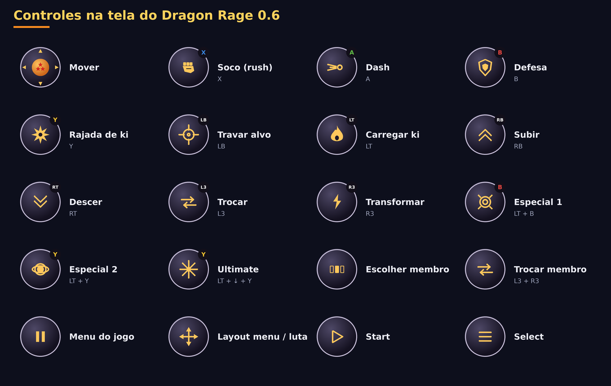

# Dragon Rage 0.6.0

A maior atualização até agora: **todas as novidades do port para PC**, um **novo menu dentro do jogo feito para toque**,
o app **identifica sua GPU e sugere configurações para 30 fps estáveis**, **download de drivers** para Snapdragon, uma
página de **Depuração** com log de desempenho, o novo controle na tela **Dragão**, **orientação retrato e automática**
e **espanhol**.

## Destaques

### Todas as novidades do port para PC
- **Tenkaichi Budokai Online**: o menu principal ganhou telas online próprias (partida rápida, criar sala, entrar com
  código, perfil), desenhadas no estilo do jogo.
- **Fontes de menu, de batalha e de diálogo** para escolher (página Interface do menu dentro do jogo) e **painéis de
  lutadores** para as barras laterais da imagem em 4:3.
- **Profundidade precisa**: duas superfícies no mesmo plano (uma cachoeira sobre a rocha, marcas no chão) não piscam
  mais, e os pontinhos brancos nos personagens brilhantes sumiram. As sombras planas não mostram mais partes do corpo
  sobrepostas (stencil).
- **Músicas em MP3**: um `.mp3` na pasta de músicas é convertido pelo próprio jogo.
- **Dragon History**: *Lutar de Novo* no menu de pausa. Online: uma seed por partida, as opções de câmera do outro
  jogador limitadas aos valores válidos, o menu de pausa não trava mais uma luta online, requisições assinadas ao serviço
  de matchmaking.
- O código do port para PC agora está sob a **AGPL-3.0** (veja o README); o Dragon Rage acompanha.

### Um novo menu dentro do jogo
- Feito para dedos e controles, nas cores do launcher: uma barra lateral de páginas, chaves grandes, opções em fileiras
  de botões, sliders largos; L1 / R1 trocam de página, B volta.
- Em **inglês, português ou espanhol**, igual ao app.
- Páginas: Vídeo, **Desempenho** (profundidade precisa, pular quadros, movimento suave, modo de apresentação, um painel de
  diagnóstico com taxa de quadros, GPU, renderizador, resolução e aparelho), Efeitos, Áudio, Interface, Controles
  (confrontos, controle físico), **Online** (como funciona e o que fazer quando falha) e Trapaças.
- As opções exclusivas do PC saíram (tela cheia, monitor, V-sync, atalhos de teclado). *Sair para o app* fica no topo.

### Sua GPU, a 30 fps
- O app lê o nome da sua GPU e encontra o **nível** dela numa tabela com as famílias de GPU dos últimos dez anos (Adreno,
  Mali, Immortalis, Xclipse, PowerVR, Maleoon): entrada, fraca, intermediária, forte ou topo de linha.
- Na primeira abertura ele mostra *"Detectamos sua GPU: … Para manter as lutas em 30 quadros por segundo estáveis, vamos
  aplicar estas otimizações:"* com a lista (resolução, movimento suave, profundidade precisa, pular quadros, desfoques) e
  pergunta. Nada muda sem o seu sim; a *Depuração* oferece de novo.
- **O renderizador automático agora é Vulkan em todas as GPUs.** A 0.5.0 escolhia OpenGL ES para Mali, mas as lutas de
  uma Mali-G52 rodavam a 2–3 quadros por segundo assim. O renderizador OpenGL ES também ficou muito mais rápido na Mali:
  os dados de uniform agora vão para um anel de buffers em vez de um único buffer reescrito 2 000 vezes por quadro.
- Novas configurações: **Profundidade precisa** (desligada é mais rápido em GPUs fracas) e **Pular quadros em vez de
  ficar lento**.

### Drivers
- Uma página **Drivers**: as versões mais recentes de **Mr. Purple**, **StevenMXZ** e **K11MCH1**, direto do GitHub,
  baixadas, instaladas e selecionadas com um toque; importe um `.zip` dos seus arquivos; remova os que você não usa.
- Numa GPU que não é Adreno, a página avisa que drivers personalizados não se aplicam ali.

### Depuração
- Seu aparelho (modelo, SoC, Android, RAM), a GPU e o nível dela, o renderizador.
- **Log de desempenho**, ligado por padrão e sem custo perceptível: a velocidade da última sessão nas lutas e nos menus e
  os quadros por segundo, lidos do log do jogo.
- *Exportar log* (veio das Configurações para cá).

### Controle na tela
- Novo visual **Dragão**, o padrão: botões redondos escuros com ícones dourados, letras nas cores do Xbox (A verde,
  B vermelho, X azul, Y amarelo; LB, RB, LT, RT, L3), uma Esfera do Dragão de três estrelas no analógico. O visual
  **Vidro** da 0.5 e o controle clássico continuam como opção (página Controles).
- **Correção: no modo história, o layout automático de menu / luta às vezes ficava preso nos botões de luta** no mapa e
  nos diálogos: o jogo mantém a última luta marcada como em andamento ali. Agora o motor avisa quando os menus dele estão
  rodando.

### Launcher
- **Espanhol**, e o idioma do app segue o do celular (português, inglês ou espanhol; inglês nos demais casos).
- **Orientação**: paisagem, retrato (a imagem em cima, os controles embaixo) ou automática.
- Um novo botão **Jogar** com aura de ki, silhuetas genéricas de lutadores no fundo, links para YouTube, Discord,
  Ko-fi e GitHub, e um card **Online** explicando como o online funciona e o que fazer quando não conecta.

## Notas da atualização
- Instala por cima da 0.5.0 e mantém dados do jogo, configurações, saves, pacotes de texturas e o layout do controle.
- Seu controle mantém as letras; o visual passa a ser Dragão (Controles → Visual → Vidro traz o antigo de volta).
- O app continua precisando da sua própria imagem de disco da versão americana (SLUS-21678); ele não distribui nenhum
  dado do jogo.
